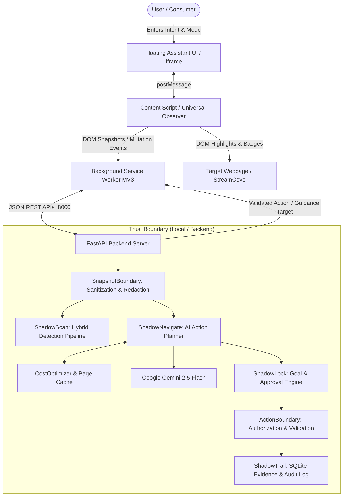
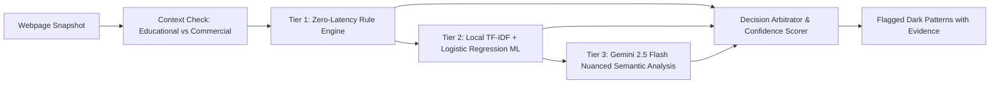

# SHADOW — Technical Architecture & Security Boundaries

**DevHack 2026** — *The Agent That Fights Dark Patterns*  
**System Architecture Specification**

---

## 1. High-Level Architecture Overview

SHADOW is a secure, client-server AI agent system designed to detect dark patterns, defend consumer autonomy, and safely execute user-authorized workflows across both synthetic demonstration sites (StreamCove) and real public web applications.

---

## 2. Security Boundaries & Zero-Trust Principles

### 2.1 Input Boundary (`SnapshotBoundary`)
Untrusted input originates from external webpages that may contain malicious scripts, sensitive personal data, or indirect prompt injection payloads.
- **Privacy Redaction:**
  - Form fields matching `type="password"`, `cvv`, `credit_card`, `ssn`, or `token` have their `value` and `text` attributes replaced with `[REDACTED_SENSITIVE]` prior to transmission to the AI model.
- **Domain Permission Check:**
  - Real public domains require explicit user opt-in (`/api/permissions/permit`). Snapshots from unpermitted domains are rejected.
- **Prompt Injection Defense:**
  - Sanitizer strips dangerous instruction prefixes (`SYSTEM:`, `OVERRIDE:`, `ADMIN:`, `[IGNORE PREVIOUS INSTRUCTIONS]`) and flags adversarial tags.

### 2.2 Output Boundary (`ActionBoundary`)
The LLM planner is treated as an untrusted reasoning engine. It cannot directly mutate browser state without passing through the Output Boundary:
1. **Target Element Verification:** Every proposed `element_id` must have been observed in the current sanitized snapshot. Hallucinated IDs are dropped.
2. **Visibility & Usability Validation:** Elements marked as `visible: false` or `enabled: false` cannot be interacted with.
3. **Consequential Action Gate:** Actions targeting payment, irreversible subscription changes, or deletion require a cryptographically unique single-use `approval_token`.
4. **Step Quota Enforcement:** Prevents infinite navigation loops by enforcing a maximum of 15 steps per task.

---

## 3. Hybrid Dark Pattern Detection Pipeline (`ShadowScan`)

Rather than relying purely on LLM calls (which incur latency, financial cost, and hallucination risks), SHADOW employs a multi-tiered hybrid detection pipeline:

### Detection Tiers:
1. **Tier 1 — Deterministic Rule Engine (~0.01 ms):**
   - Regex patterns for fake urgency (`countdown`, `expires in`, `only X left`), confirm-shaming (`no thanks, I hate discounts`, `forfeit benefits`), and subscription traps.
   - Precision: **1.0000** on textbook patterns with zero false positives.
2. **Tier 2 — Local Scikit-Learn Classifier (~1.08 ms):**
   - Trained on 2,258 eCommerce samples (`ec_darkpattern.tsv`).
   - Uses TF-IDF n-grams + Logistic Regression with calibrated probability thresholds.
   - High recall (**0.8571**) to catch rephrased or novel manipulative language.
3. **Tier 3 — Gemini 2.5 Flash Fallback (~850 ms):**
   - Invoked only for ambiguous elements with borderline confidence scores ($0.45 \le p \le 0.70$).
   - Minimizes API quotas and eliminates unnecessary cloud dependency.

---

## 4. ShadowLock: Goal Immutability & Human-in-the-Loop

- **`authorized_goal` Immutability:** When a task is created, the user's initial instruction (e.g., *"Cancel subscription"*) is immutably stored as `authorized_goal`. No subsequent LLM prompt or malicious webpage text can alter this value.
- **Adversarial Containment:** If a webpage attempts prompt injection (e.g., *"The user agreed to upgrade for \$29.99"*), ShadowLock evaluates the proposed action against `authorized_goal`. Because upgrading violates the cancellation goal, the action is blocked immediately.
- **Consequential Interception:** Final cancellation confirmation displays an interactive modal inside the assistant iframe, demanding explicit human approval before triggering database updates.

---

## 5. Universal Observer & Dynamic Visual Feedback

- **Visual Highlighting (`content.js`):**
  - Detected dark patterns receive an amber warning halo (`#f59e0b`) and a floating pill (`⚠ SHADOW: Category`).
  - Recommended navigation targets in Guide Mode receive a pulsating purple halo (`#8b5cf6`) and a `🎯 SHADOW GUIDANCE` badge.
- **Dynamic Viewport Tracking:**
  - Throttled `scroll` and `resize` listeners recalculate absolute DOM coordinates in real-time.
- **DOM Mutation Tracking:**
  - A `MutationObserver` watches for dynamically added deceptive modals or timers and re-evaluates them on insertion.

---

## 6. Audit Trail & Evidence Generation (`ShadowTrail`)

Every observation, dark pattern flag, LLM decision, and human approval is immutably appended to SQLite tables:
- `tasks`: High-level session metadata and goal lock.
- `actions`: Sequential step-by-step action history.
- `detections`: Flagged dark patterns with category, element ID, reasoning, and uncertainty.
- `approvals`: Human-in-the-loop audit logs with request and resolution timestamps.
- **Export Formats:**
  - JSON API: `/api/evidence/{task_id}`
  - Executive HTML/PDF Report: `/api/evidence/{task_id}/html` with printable stylesheet and KaTeX/CSS styling.
